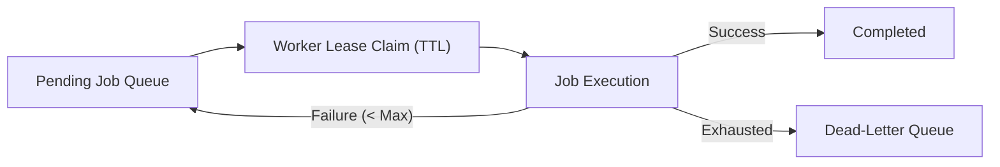

# Distributed Lease-Based Job Scheduler (Java 21)


**Stack:** `Java 21 · Lease Coordination · Bounded Retries · Dead-Letter Queue`

## Overview
A distributed task coordination engine implementing time-bounded worker leases, exclusive job claiming, expired-lease recovery, and dead-letter isolation after bounded retry exhaustion.

## Architecture & Execution Flow


## Key Engineering Capabilities
- **Time-Bounded Exclusive Leases:** Prevents concurrent workers from executing the same scheduled job simultaneously.
- **Stale Lease Recovery:** Reclaims jobs from stalled workers once lease TTL expires.
- **Bounded Retry & Dead-Letter Routing:** Transitions persistently failing jobs to a dead-letter state after configured retry limits.
- **Continuous CI Verification:** Executed via `java Main.java` on GitHub Actions.

## Local Verification
Run the self-contained verification suite locally:

```bash
java Main.java
```

## Documentation
- [Architectural Decisions](docs/DECISIONS.md)
- [Security & Isolation Model](docs/SECURITY.md)
